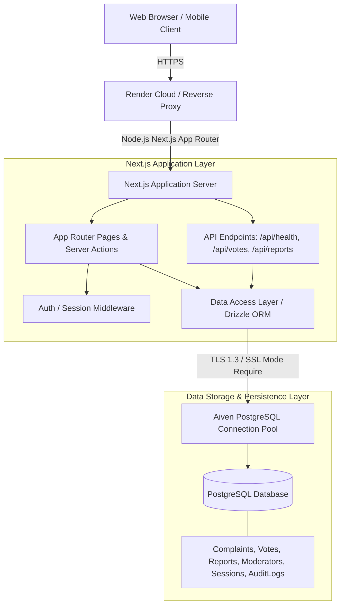

# System Architecture: EARTH MODS

## 1. High-Level Architecture Overview

EARTH MODS is designed as a secure, high-performance, full-stack application running on Next.js App Router with Node.js runtime, backed by a managed PostgreSQL instance on Aiven and deployed to Render as a Web Service.

---

## 2. Technology Stack & Key Decisions

| Component | Choice | Rationale |
|---|---|---|
| **Framework** | Next.js 15+ (App Router) | High-performance React Server Components (RSC), streamlined Server Actions for mutations, server-rendered SEO metadata for complaint case pages. |
| **Language** | TypeScript (Strict Mode) | Full type safety across API boundaries, Drizzle schema, and UI props. Zero `any` tolerance. |
| **Styling** | Tailwind CSS v3/v4 | Custom institutional theme tokens (Bureaucracy Green, Archival Parchment, Formal Gold, Seal Red, Muted Slate). |
| **Database** | PostgreSQL on Aiven | Managed relational database with strict ACID guarantees, atomic transactions, row-level locking for vote tallies, and TLS enforcement. |
| **ORM & Migrations** | Drizzle ORM + Drizzle Kit | Lightweight, zero-overhead SQL-first ORM with full TypeScript infer types and deterministic SQL migrations. |
| **Database Driver** | `postgres` (postgres.js) / `pg` | High performance connection pooler with SSL support for Aiven's managed CA certificates. |
| **Validation** | Zod v3 | Comprehensive input validation for complaints, votes, queries, and admin operations. |
| **Security & Auth** | Node.js Web Crypto / Scrypt + Signed Cookies | Cryptographically secure password hashing, HttpOnly SameSite cookie sessions, SHA-256 voter fingerprinting with server salt. |
| **Deployment** | Render Web Service | GitHub-linked auto-deployment, native Node.js process with dynamic `PORT` binding. |

---

## 3. Database Schema Design & Normalization

### Tables
1. **`complaints`**:
   - `id`: `UUID` (Primary Key, default `gen_random_uuid()`)
   - `case_number`: `VARCHAR(32)` UNIQUE (e.g., `EM-2026-89412`)
   - `title`: `VARCHAR(180)` NOT NULL
   - `description`: `TEXT` NOT NULL
   - `category`: `VARCHAR(64)` NOT NULL (`PHYSICS`, `ATMOSPHERIC`, `BIOLOGY`, `TEMPORAL`, `INFRASTRUCTURE`, `OTHER`)
   - `author_name`: `VARCHAR(60)` NULL (Display name, or NULL if anonymous)
   - `is_anonymous`: `BOOLEAN` DEFAULT TRUE
   - `status`: `VARCHAR(32)` DEFAULT `'PENDING_REVIEW'` (`PENDING_REVIEW`, `UNDER_INVESTIGATION`, `RESOLVED`, `DISMISSED`, `CANONIZED`)
   - `verdict`: `TEXT` NULL (Official planetary moderation finding)
   - `verdict_by`: `VARCHAR(100)` NULL (e.g., "Senior Archon of Gravitational Affairs")
   - `verdict_date`: `TIMESTAMP WITH TIME ZONE` NULL
   - `upvotes_count`: `INTEGER` DEFAULT 0
   - `downvotes_count`: `INTEGER` DEFAULT 0
   - `score`: `INTEGER` DEFAULT 0 (`upvotes - downvotes`, indexed for sorting)
   - `report_count`: `INTEGER` DEFAULT 0
   - `created_at`: `TIMESTAMP WITH TIME ZONE` DEFAULT NOW()
   - `updated_at`: `TIMESTAMP WITH TIME ZONE` DEFAULT NOW()

2. **`votes`**:
   - `id`: `UUID` (Primary Key)
   - `complaint_id`: `UUID` REFERENCES `complaints(id)` ON DELETE CASCADE
   - `voter_hash`: `VARCHAR(64)` NOT NULL (SHA-256 of visitor cookie/token + server secret)
   - `vote_type`: `SMALLINT` NOT NULL (+1 for upvote, -1 for downvote)
   - `created_at`: `TIMESTAMP WITH TIME ZONE` DEFAULT NOW()
   - *Constraint*: `UNIQUE(complaint_id, voter_hash)` ensures strictly one vote per voter identity per complaint.

3. **`reports`**:
   - `id`: `UUID` (Primary Key)
   - `complaint_id`: `UUID` REFERENCES `complaints(id)` ON DELETE CASCADE
   - `reason`: `VARCHAR(64)` NOT NULL (`SPAM`, `HARASSMENT`, `LEGAL`, `OFF_TOPIC`, `DUPLICATE`)
   - `details`: `TEXT` NULL
   - `reporter_hash`: `VARCHAR(64)` NOT NULL
   - `status`: `VARCHAR(32)` DEFAULT `'PENDING'` (`PENDING`, `REVIEWED`, `DISMISSED`)
   - `created_at`: `TIMESTAMP WITH TIME ZONE` DEFAULT NOW()

4. **`moderators`**:
   - `id`: `UUID` (Primary Key)
   - `username`: `VARCHAR(50)` UNIQUE NOT NULL
   - `email`: `VARCHAR(255)` UNIQUE NOT NULL
   - `password_hash`: `VARCHAR(255)` NOT NULL
   - `role`: `VARCHAR(32)` DEFAULT `'MODERATOR'` (`ADMIN`, `MODERATOR`)
   - `is_active`: `BOOLEAN` DEFAULT TRUE
   - `created_at`: `TIMESTAMP WITH TIME ZONE` DEFAULT NOW()
   - `last_login_at`: `TIMESTAMP WITH TIME ZONE` NULL

5. **`sessions`**:
   - `id`: `UUID` (Primary Key)
   - `token_hash`: `VARCHAR(64)` UNIQUE NOT NULL (SHA-256 of session token)
   - `moderator_id`: `UUID` REFERENCES `moderators(id)` ON DELETE CASCADE
   - `expires_at`: `TIMESTAMP WITH TIME ZONE` NOT NULL
   - `created_at`: `TIMESTAMP WITH TIME ZONE` DEFAULT NOW()

6. **`audit_logs`**:
   - `id`: `UUID` (Primary Key)
   - `moderator_id`: `UUID` REFERENCES `moderators(id)` ON DELETE SET NULL
   - `action`: `VARCHAR(64)` NOT NULL (e.g., `APPROVE_COMPLAINT`, `UPDATE_VERDICT`, `HIDE_COMPLAINT`)
   - `target_type`: `VARCHAR(32)` NOT NULL (`COMPLAINT`, `REPORT`, `MODERATOR`)
   - `target_id`: `VARCHAR(64)` NOT NULL
   - `details`: `JSONB` NULL
   - `created_at`: `TIMESTAMP WITH TIME ZONE` DEFAULT NOW()

---

## 4. Voter Identity & Privacy Architecture

- When a visitor visits Earth Mods, a cryptographically secure random `voter_token` (UUIDv4) is generated and stored in a secure, HttpOnly, SameSite=Lax cookie.
- When voting on a complaint, the voter token combined with a server-side salt (`VOTER_SALT`) is hashed using SHA-256.
- The raw IP address is **never stored permanently in the database**. Short-lived in-memory or sliding window maps handle anti-flooding rate limits.
- The database enforces a `UNIQUE(complaint_id, voter_hash)` index. Duplicate votes flip or remove the vote cleanly, updating the tally in an atomic SQL transaction.

---

## 5. Render & Aiven Production Connection Lifecycle

- **Aiven TLS**: Aiven PostgreSQL requires TLS connections. Connection strings must specify `?sslmode=require`. In Drizzle/postgres.js or node-postgres, `ssl: { rejectUnauthorized: false }` or Aiven's Root CA certificate is configured so connections never downgrade to plaintext.
- **Connection Pooling**: Postgres connection pooling is capped to avoid overwhelming database limits during bursts.
- **Port Binding**: The Render web service supplies `PORT` dynamically. The start script executes `next start -p $PORT -H 0.0.0.0`.
